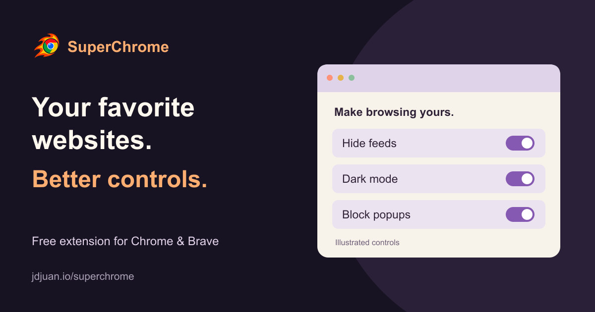

# SuperChrome



A small browser toolkit for Chrome and Brave. [See it in action and install](https://jdjuan.io/superchrome).

## Tools

- **Five-second rewind:** press ← while watching YouTube or Netflix to rewind five seconds. Enabled by default; toggle it in **Video Shortcuts → Five-second rewind**. Supports embedded YouTube players too. Refresh existing video tabs after reloading the extension. Typing fields, menus, dialogs and modified arrow shortcuts keep their normal behavior. No new permissions.

- **YouTube:** Feed → YouTube has one Hide distractions switch. Simple mode hides the Home feed, Shorts shelves/navigation and related-video sidebar. Custom exposes only Feed, Shorts and Sidebar related videos; choices persist when switching modes. On by default. Search, subscriptions, comments, playlists, live chat and deliberately opened videos (including direct Shorts links) remain available. These settings do not add timed breaks or change the separate Brave playback retry.

- **Feed:** hide Instagram Home posts, stories and suggestions, X Home and LinkedIn Home feeds. Messages and notifications stay available. Reveal feeds for 1, 3 or 5 minutes, then hide them again. Specific LinkedIn post URLs, including highlighted posts under `/feed/`, remain visible; saved element hides are suspended while viewing a specific post.
- **LinkedIn suggestions:** a separate checkbox hides notification cards explicitly marked `REACTIONS_BY_YOUR_NETWORK`, including activity by connections on someone else’s posts. Personal reactions/comments, mentions, and unknown types remain visible. This conservative first filter does not guess from quoted text. A second checkbox, **Hide game invites**, hides notification cards whose only destinations are LinkedIn Games pages (for example “X completed Zip. Your turn”). Both are on by default under **Feed → LinkedIn → Customize**. A local summary lets you show hidden cards again. It does not delete notifications, mark them read, or alter LinkedIn’s server-side bell count.
- **Hide an element:** pick something on a website and remember it. W selects a larger container, S a smaller one, Esc cancels. Restore saved rules in Feed. Rules may need updating when a site changes.
- **Save:** download YouTube, Instagram and X videos to `~/Downloads`. Instagram and X save directly from the extension: Instagram uses your signed-in session to find the post's MP4, X uses its public embed data. YouTube needs the optional local Python, yt-dlp and FFmpeg helper; the popup shows its setup prompt only for YouTube links or when a direct download fails. Download only media you have permission to save.
- **Instagram media:** the same small download arrow saves post photos and videos, including individual carousel slides. Videos save as Instagram's own MP4 (video + audio) without the helper. Private or blocked posts fall back to the helper if it is installed. If Instagram blocks the image request, the button offers a retry.
- **Stats:** inspect available Facebook reel dates/views. Some reels do not expose metadata.
- **Instagram stats badge:** open any Instagram post or reel and a small badge at the top right shows its upload date (for example “15 Oct”), views, likes, comments, sends and saves. Hover a number for the exact count; × hides it for that post. Toggle it in **Video Stats → Show stats on Instagram posts** (on by default). **Video Stats → Show date & views** reports the same values. Requires being signed in to Instagram; it reads the same post-info request Instagram’s web app uses, so an Instagram change may break it. Saves (and views on photo posts) come from Insights, so they appear only on your own posts; if Instagram changes that query, saves are omitted. Public counts only otherwise. No new permissions.
- **Instagram grid stats:** on profile grids (Posts, Reels, Tagged and Saved tabs) each tile shows a labeled chip: upload date, then views, likes, comments, sends and saves. Tiles load as they scroll into view, six at a time (a 12-tile row takes about a second), pausing for a minute if Instagram rate-limits. Numbers appear first; on your own profile saves are requested in parallel and fill in right after. Results are kept for 10 minutes in the tab's session storage, so revisiting a profile is instant. Toggle it in **Video Stats → Show stats on profile grids** (on by default). Chips sit on photos, so they use their own dark scrim with white text.
- **Films:** block unwanted popups on Cuevana/Cineb by default, other sites opt-in. Some legitimate external links may need protection turned off.
- **Brave:** automatically reload YouTube once per video per tab when its ad-blocker warning blocks playback. Keeps your ad blocker enabled; playback is not guaranteed. Runs only in Brave.

## Installation

1. [Download the latest release](https://github.com/jdjuan/SuperChrome/releases/latest/download/SuperChrome.zip) and unzip to a permanent folder.
2. Open `chrome://extensions` or `brave://extensions`, enable Developer mode and choose **Load unpacked**. Select `SuperChrome`, the folder containing `manifest.json`.
3. Pin the extension and choose your tools. Instagram and X downloads work right away. For YouTube downloads, open **Download Video → Copy Prompt** and give the setup instructions to an AI with local computer access.

Cloning this repo is also supported: load its `extension` folder. The manifest key preserves extension ID `lfbikaodomamodnmfheahbcbkdkaggai`. A clone alone does not install/register the download helper.

## Updates

When you open the popup, SuperChrome checks the latest public GitHub release, at most once per day. **Check updates** retries immediately. New versions show **Copy update prompt**, with a pinned release URL and checksum file. The prompt guides an AI through replacing files in place, preserving the extension ID and browser storage. Browsers block AI tools from reloading extensions, so SuperChrome reloads itself: once the new files are on disk, it finishes the update the next time you focus Chrome, switch tabs or load a page. If the popup is opened first, it shows only a **Finish updating** button (an **Open the extensions page** link in the update steps is the last-resort fallback). Refresh open websites afterwards. Updates are not silently installed.

The website uses GitHub's permanent latest-release URL, so it does not need a version edit with every release. Released ZIPs include the extension, portable helper source and installation instructions. SHA256SUMS.txt provides an integrity check, not an independent publisher signature.

## Development and releases

```sh
npm ci
npm test
npm run package
```

Release assets are generated under ignored `work/release/`. Bump `extension/manifest.json` and `package.json` together, then push to `main`. GitHub Actions verifies tests and publishes a release for each new manifest version. Never overwrite a published version: make a new one. Keep the manifest key stable.

The test suite covers feed routing/timers, element hiding, light/dark contrast, popup behavior, native messaging, helper setup, and update checks. Real website layouts and actual downloads still require loaded-browser checks.

## Permissions and privacy

Uses `activeTab`, `scripting`, `storage`, `nativeMessaging`, `webNavigation` and `downloads`, plus host access to `cdn.syndication.twimg.com`. Website content scripts apply hiding rules and popup protection, which defaults off outside Cuevana/Cineb. Facebook inspection runs when clicked. Save hands Instagram/X MP4 addresses to Chrome's downloads manager (`downloads`), reads X post video variants from X's public embed API (`cdn.syndication.twimg.com`), and passes YouTube URLs to the local helper, which contacts the video provider. Settings stay in browser storage.

The update check sends a standard public API request to GitHub with no credentials, page URLs or browser preferences. GitHub receives normal connection metadata such as your IP address. No extra extension permissions, analytics or SuperChrome hosted backend are used. GitHub's API supports CORS for this request.

Uninstall through the extensions page. Remove the optional native-host registration and helper files separately; keep shared Python/yt-dlp/FFmpeg dependencies if other tools need them.

## Gmail dark mode (3.5)

**Appearance → Gmail: follow system theme** darkens the Gmail inbox, opened messages, menus, and compose/reply windows. It follows system appearance by default, automatically enabling dark colors only while the system is dark, works across Gmail accounts in the browser, and saves its preference locally per browser. Gmail tabs open the Appearance tool automatically. Turning it off restores Gmail’s underlying theme immediately.

Each opened message has a **Show original colors** button outside its content. This restores that message’s original design on a light reading surface; **Use dark colors** switches it back. The choice lasts while that message DOM remains open. Photos and logos are not inverted. Dark message rendering normalizes text/background colors and suppresses CSS background images; original colors restore those designs. Embedded cross-origin Google apps (Calendar, Keep, Contacts, Chat, etc.) and attachment previews are outside the scope of this feature.

`gmail-dark.js` batches DOM changes and maps Gmail’s computed surface/text colors to paired dark colors, without depending on its shell’s generated class names. A few stable Gmail selectors identify message bodies, editors, inbox states and monochrome icons. Site theme changes and newly inserted content are reclassified with our stylesheet temporarily gated off during the same task. All CSS is gated by one root attribute. It does not change Gmail account settings or write styles/controls into editable message content. No Gmail API, network service, or additional permissions are used.

Local tests cover toggles and storage failures, startup/account URLs, dynamic messages, runtime theme changes, original-color controls, message/editor HTML integrity, site isolation and at least 4.5:1 text contrast on all four dark surfaces. Chrome live verification covered the inbox, an opened message, original-color switching, monochrome icons, an untouched compose window and immediate restoration through the popup toggle. SuperChrome was reloaded in Chrome and Brave with its stable extension ID. Gmail or email markup changes may require selector adjustments.

### Gmail message-opening flash (3.5.1)

New and reused Gmail panels are classified directly in the mutation observer’s batch, before the next rendering opportunity. Removing the previous 80 ms timer prevents the initial white conversation container from painting when opening an email. Original-color controls and the off toggle retain their behavior. Regression tests assert that inserted conversation shells, headers and reused surfaces are styled by mutation delivery without waiting for a timer.

## LinkedIn dark mode (3.6)

**Appearance → LinkedIn: follow system theme** darkens LinkedIn independently of Gmail and Feed focus. It follows system appearance by default, updates open tabs automatically when the system changes, and persists its opt-out locally per browser. The feature covers feeds, profiles, notifications, jobs, menus, post/comment composers and messaging. Switching it off immediately restores the site's own theme, including an existing native dark theme; it does not change LinkedIn account preferences.

The content script maps computed surface/text colors instead of relying on LinkedIn's generated layout classes. It handles new content during mutation delivery before paint, preserves photos, banners and colored logo artwork, and styles editors through CSS without adding attributes or formatting to their contents. LinkedIn's open `#interop-outlet` shadow root receives a small separately scoped stylesheet and observer for embedded messaging. Same-origin LinkedIn frames are included; third-party ads and external embedded documents are outside this scope. Existing focus and notification overlays refresh their own palettes to match the restored/active page theme.

No permissions were added. Tests cover dynamic panels before paint, SPA routes, same-origin frame URLs, original-theme restoration, independent storage/error rollback, media/editor integrity, messaging shadow content, focus overlay themes under both OS preferences and at least 4.5:1 text contrast. Chrome live verification covered the Feed focus surface, Notifications and immediate restoration of the page and messaging theme gates through the independent popup toggle; generated layout classes and private message content are not stored in the repository.

### System appearance (3.6.2)

Gmail and LinkedIn listen for live system color-scheme changes. Light mode removes the extension’s dark styling and restores the site’s own theme; dark mode reapplies it, including LinkedIn messaging. The Appearance switches enable or disable this automatic behavior. No account theme preferences or extension permissions change.

### Popup controls (3.7.1)

Films lists protected websites, including Cuevana domains and cineb.st by default. Add or stop protection for the active hostname using a named action, remove entries from the list, or pause protection globally without losing the list. Default-family removals persist; adding an individual domain back protects that domain. Changes synchronize between open popup views. Existing explicit hostname exceptions are retained.

Feed uses compact website cards. YouTube has an on/off switch and visible Simple/Custom buttons; the custom choices describe the Home feed, Shorts shelves/shortcuts and related-video sidebar. Disabling YouTube collapses its options without losing saved custom choices. Colors use the existing paired light/dark palettes.

### Compact Feed (3.7.2)

Replaced website cards with plain checkbox rows. YouTube’s settings are behind a collapsed Customize disclosure; All three and Choose retain the existing saved modes and individual choices. Removed repeated descriptions and icons.

### LinkedIn responsiveness and startup (3.7.3)

Dark-mode classification now reads computed colors before writing classification attributes, processes at most 200 elements per task, and coalesces mutation bursts. This avoids alternating style invalidation and computed-style reads for every element in a large LinkedIn update. A dark baseline covers semantic page panels while queued classification finishes; startup backgrounds follow system appearance while settings load. Detailed classification runs after yielding, rather than blocking mutation delivery. Ancestor filtering avoids pairwise comparisons of all changed roots.

LinkedIn's `#interop-outlet` shadow attachment now emits a synchronous notification from the existing main-world guard. Feed focus installs its scoped hiding rules at attachment, before LinkedIn populates the root, while retaining the existing host cover and repair observer. No permissions or account preferences change.

Chrome was found running the older 3.7.0 scripts until the unpacked extension was explicitly reloaded. The hung LinkedIn tab reported `RESULT_CODE_HUNG`. After reloading 3.7.3 with the same extension ID, Feed rendered dark with posts hidden and Notifications loaded dark and remained interactive. This establishes recovery in the tested session, not a controlled attribution of every prior hang or a guarantee against future LinkedIn layout changes. Tests cover synchronous shadow-rule installation and bounded, coalesced read/write batches in addition to existing routing, theme, editor and media checks.

### LinkedIn scroll processing (3.7.4)

The 3.7.3 batching change still switched the page-wide dark gate off and on for every batch. Local Chrome diagnostics measured a 286.7 ms batch on a profile with roughly 3,400 document elements, so a successful navigation check did not establish smooth scrolling.

Classification now temporarily excludes only the elements in a 50-element batch from our color rules. The page-wide gate stays enabled. Class and paint attribute changes reclassify only the changed element; inserted subtrees still receive classification. Inline changes to layout properties such as transform and height do not schedule dark-mode work. Changes to colors and custom properties remain tracked. Existing restoration, editor/media integrity, frame/shadow rules and theme preferences remain in place.

For local timing inspection, load a LinkedIn test URL with the exact fragment `#superchrome-performance`. Only that document exposes cumulative batch count, total milliseconds and maximum batch duration in its root `data-sc-perf` attribute. These timings contain no content, are never sent or persisted, and are disabled on ordinary pages. Refresh existing tabs after reloading the unpacked extension: an extension reload does not replace scripts already running in those documents.

The full local suite passes, including regressions for zero work on scroll transforms, a one-element read for a class change on a parent with 650 descendants, and no page-wide theme gate mutations during classification. After the unpacked-extension reload, Juan confirmed that scrolling works much better. This is user-observed improvement; no controlled before/after frame-time comparison was completed. Browser automation rejected access to the extensions page, so Juan performed the reload.

### Gmail scroll processing (3.7.5)

Gmail now uses the same local sampling approach as LinkedIn 3.7.4: its page-wide dark theme stays active during classification, DOM changes coalesce into scheduled batches of at most 50 elements, and attribute changes update only the changed element. Inline layout changes such as transforms and heights schedule no classification. Color and custom-property changes remain tracked. Semantic conversation panels receive a CSS baseline while classification catches up.

Computed colors are read before classification attributes are written. Temporary sampling attributes never enter message bodies or editors. Original-color controls remain outside message content, refresh on structural changes, and retain their existing toggle and cleanup behavior. No permissions change. Local regression checks cover large mutation batches, unchanged page-wide theme gates, zero work for layout-only scrolling updates, a one-element read for a parent class update with 650 descendants, original colors, draft/message integrity and theme restoration. After Juan reloaded the extension and Gmail, Chrome verification covered the dark inbox, opening and scrolling a long message, switching to original colors and back to dark, and returning to the inbox. No sampling attributes remained after processing. These interaction checks establish functionality in the tested session; no controlled frame-time benchmark was performed.

### LinkedIn root-URL startup (3.7.6)

Signed-in LinkedIn can paint feed posts at `/` before replacing the address with `/feed/`. Focus previously recognized only `/feed` and `/feed/` and marked startup initialized immediately, which removed the manifest stylesheet's first-paint protection while the root URL was still visible. This reproduced the feed flash in Juan's recording.

Root `/` now receives the same feed hiding rules, including in the legacy preload frame. The startup stylesheet remains active on Home until preferences have resolved and persistent hiding rules have been installed. A separate visibility-ready attribute replaces the unconditional initialized marker. Protected shadow hosts remain covered until their scoped styles are ready. Explicit non-feed destinations open without waiting for settings, while saved breaks and disabled focus restore content once loaded. Storage failure keeps the safe default of hiding Home; a late settings read cannot overwrite a newer preference change. No new permissions or page-wide color recalculations are introduced.

Regression coverage includes pre-script hiding, delayed settings, the exact `/` to `/feed/` sequence without waiting for polling, legacy and modern posts, shadow attachment, preload frames, storage failures/races, saved breaks and non-feed destinations. After Juan reloaded the unpacked extension, a fresh Chrome visit to `https://www.linkedin.com/` reached `/feed/` with posts hidden and the new visibility-ready gate active; the old initialized marker was absent. A screenshot confirmed the dark focus surface. The browser snapshot did not capture every startup frame; the no-gap `/` to `/feed/` behavior is additionally covered by the regression tests.


## Settings clarity (3.8.0)

The wider sidebar names each tool explicitly: Hide Feed, Download Video, Video Stats, Popup Blocker, Brave YouTube and Dark Mode. Panels start with a title and a single short explanation. LinkedIn’s network reaction alert setting lives under Customize; download platforms have labeled icons. Popup Blocker keeps one global checkbox, the current-site action and a removable list of protected sites.

Video Stats reads the open individual video using existing activeTab access, without new permissions or network requests. Facebook retains its matching-video metadata inspection and optional Watch link. YouTube reads page date/view metadata; Instagram reads matching VideoObject structured data when available; X reads the matching post timestamp and public view link when present. Matching structured video metadata is also supported on YouTube and X. Missing fields are reported explicitly. This does not provide private creator analytics, and availability depends on each page.

## Fireball branding (3.8.1)

The toolbar, extensions list and popup use the approved Chrome-inspired Fireball logo. Transparent PNG icons are supplied at 16, 32, 48 and 128 pixels, with a 512-pixel source retained in `extension/icons/fireball-source.png`. No permissions or manifest key changes. Verified the complete local test suite, release packaging and the reloaded Chrome extension at its stable ID.

### Larger toolbar mark (3.8.2)

Toolbar-only PNGs remove the source artwork's transparent margins, increasing the visible mark by approximately 18% within Chrome's fixed icon slot. The popup and extension-management artwork retain their existing padding. The full local test suite and release packaging pass. Chrome reload remains manual because concurrent browser interaction interrupted UI verification.

### Instagram download feedback (3.8.4)

The on-video arrow stays busy until the helper finishes. An adjacent status shows download progress, MP4 preparation, completion in Downloads, or the actual error with a retry instruction. A checkmark means the helper confirmed completion. Status follows Instagram replacing the player element. No permissions were added.

### Carousel downloads (3.8.5)

The Instagram on-video arrow saves only the visible carousel slide, including virtualized slides. The helper checks carousel metadata before selecting an entry. If a mixed carousel cannot be matched safely, it reports an error instead of downloading other slides. Popup URL downloads can still produce multiple entries; every output now receives compatible MP4 conversion. No permissions were added.

### Video shortcut controls (3.8.7)

Added a Video Shortcuts sidebar panel and persistent five-second rewind switch that updates open players. The previous version only injected into top-level YouTube pages; embedded players now receive the shortcut, including youtube-nocookie embeds. Netflix uses its managed seek API when available, with a standard media fallback. Local regression tests cover settings changes and embedded URLs. Live playback verification remains pending.

## License

[MIT](LICENSE)

## Direct Instagram and X downloads (3.13)

Instagram and X videos no longer need the local helper. The Instagram ↓ button resolves the post's MP4 through the same post-info request Instagram's web app uses (signed-in session required) and saves it with Chrome's downloads manager; popup Instagram links resolve through an open Instagram tab. X links in the popup read the best MP4 variant from X's public embed API. Only `*.cdninstagram.com`, `*.fbcdn.net` and `video.twimg.com` media addresses are accepted. If a direct download fails, SuperChrome falls back to the helper when installed, otherwise it explains the failure and opens the helper setup. New permissions: `downloads` (save files without loading them into memory) and host access to `cdn.syndication.twimg.com` (X's embed API does not allow extension origins via CORS).

The helper no longer crashes with `[Errno 63] File name too long` when yt-dlp prints a long error on macOS's built-in Python 3.9. Its health check now runs `yt-dlp --version`, and a macOS-blocked standalone `yt-dlp_macos` (`library load disallowed by system policy`) is reported with reinstall instructions. The setup prompt now requires Homebrew or pip yt-dlp on macOS. The Instagram API lookup was verified live in Chrome (720×1280 MP4 with video and audio tracks); the full loaded-extension download flow was not exercised before release because browser automation cannot reload the unpacked extension.
